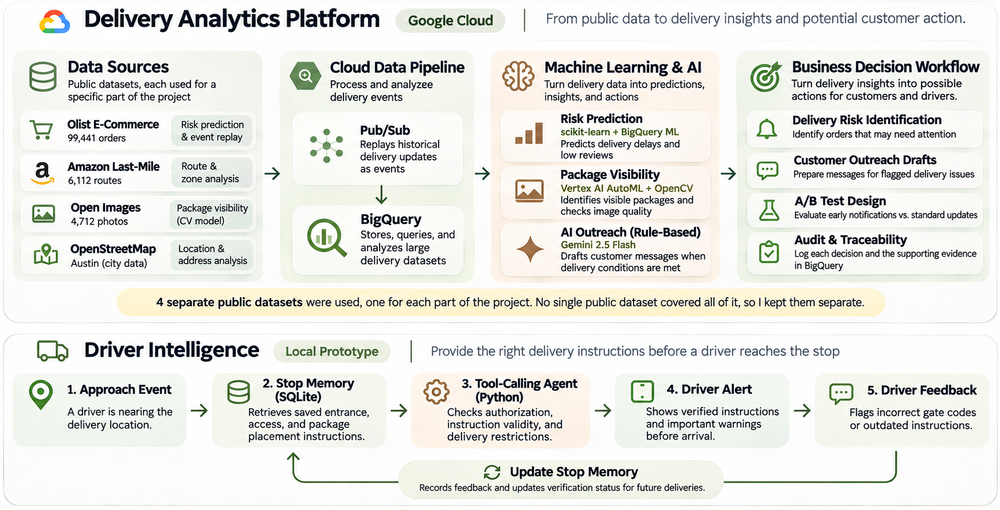
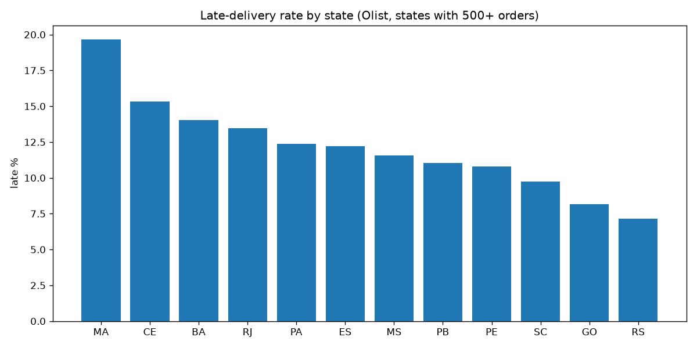
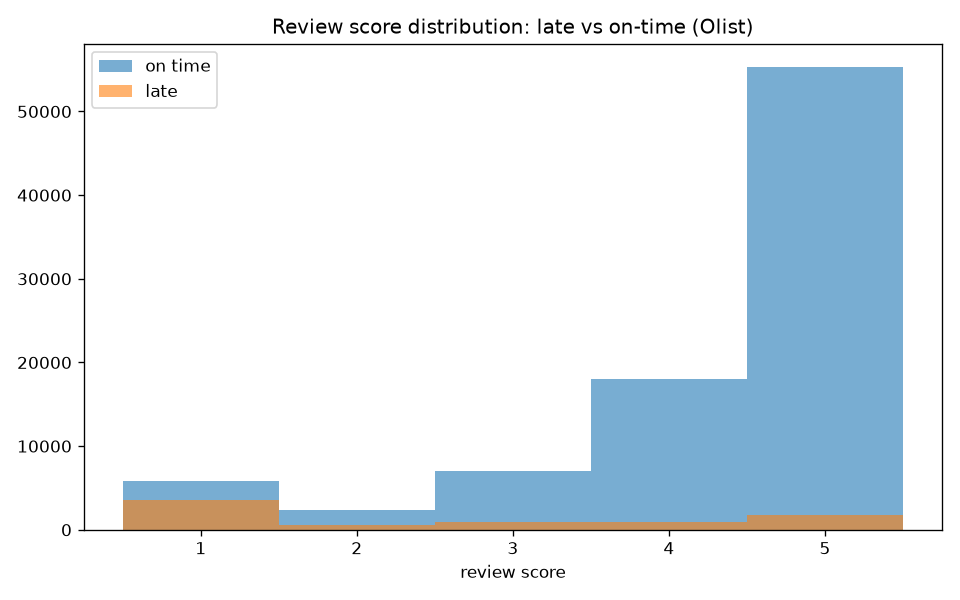
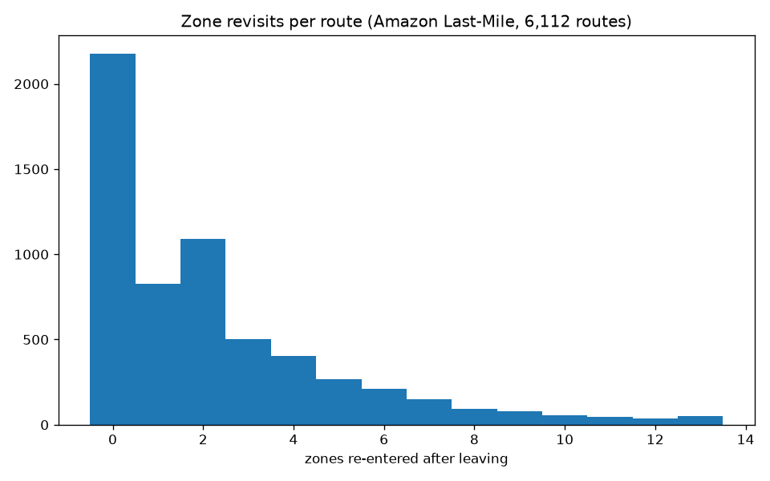
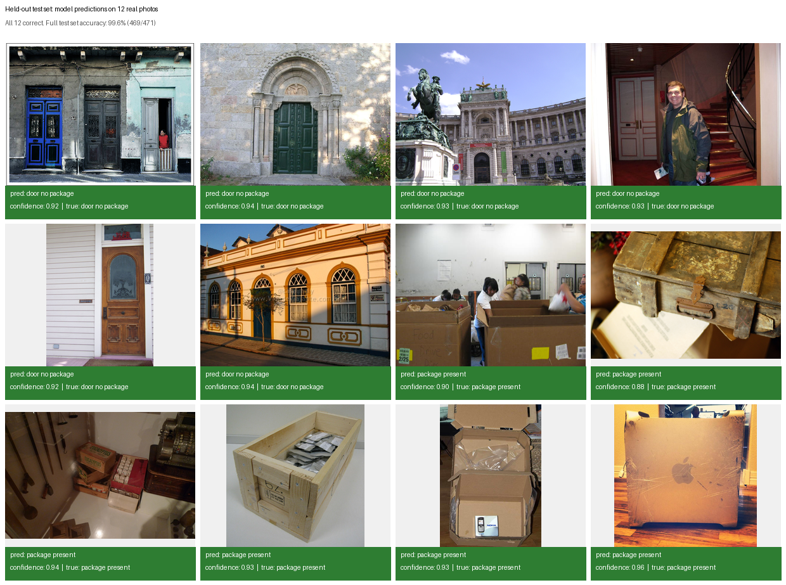

<div align="center">

# Delivery Experience Intelligence

### Predict Delivery Risks · Detect Packages with Computer Vision · Support Drivers with AI-Assisted Workflows


**[Project presentation](https://docs.google.com/presentation/d/1dMVPmu7jhGnf5r54qxO6Emqcw6QEn9v4e-NpkpGVsvw/edit?usp=sharing)**

</div>

---

## The business problem

Delivery issues can make things harder for both customers and drivers:

- **Customers:** Late deliveries, missing packages, or unclear proof of delivery can mean a frustrating experience and more support requests.
- **Drivers:** Missing entrance details, outdated gate codes, and unclear placement instructions can lead to delays, failed attempts, and unnecessary back-and-forth.

In the Olist data, about 8.1% of orders were late, which gave me a starting point for exploring delivery risk and customer reviews. 
Late orders averaged 2.6 stars against 4.3 for on-time orders. Failed attempts can send the package back on the truck and lead to support calls.

## The solution

I built a delivery analytics platform on Google Cloud using public datasets and historical event replay (simulating delivery updates using past order data), and later added a Driver Intelligence prototype that runs locally to explore how drivers can get better delivery instructions before reaching a stop.

## System Architecture


## Results at a glance

| Solution | Implementation | Measured result | Potential business use |
|---|---|---|---|
| **Delivery risk prediction** | **HistGradientBoosting** with purchase-time features and temporal validation; **BigQuery ML boosted trees** | Local ROC-AUC: **0.649** late delivery, **0.601** low review; BigQuery ML: **0.616** and **0.575** | Flag the riskiest orders so a human can check them before the customer complains |
| **Event processing** | **Pub/Sub → BigQuery** historical order-event replay | **19,770 events**, **6,235 events/sec**, **0 message loss** in benchmark | Keep order data flowing without losing events |
| **Package visibility** | **Vertex AI AutoML** classifier trained on **4,712 Open Images photos** | **99.58% accuracy (469/471)** on held-out Open Images door/box photos | Add a visibility signal to proof-of-delivery review workflows |
| **Outreach decision workflow** | Deterministic eligibility rules, **Gemini 2.5 Flash** drafting, BigQuery audit log | **500/500** decisions matched independent rule checks; **4** drafts generated | Generate traceable outreach drafts only for eligible cases |
| **Experiment design** | Customer-level randomization, power analysis, sequential monitoring | Designed for **~750 customers per arm** at **80% power** under modeled assumptions; not yet run live | Measure whether earlier notifications improve customer experience |
| **Driver Intelligence prototype** | **Python + SQLite**, stop memory, tool-driven alerts, driver feedback | **100/100** expected decisions vs **24/100** retrieval baseline on 100 author-written synthetic scenarios | Help drivers see relevant stop instructions before arrival |

Understanding the results: The risk model achieved a ROC-AUC of 0.649, showing it can help identify deliveries that may need attention, though it isn't strong enough to make decisions on its own. The 500/500 result shows that the outreach workflow followed its predefined rules correctly, but its impact on customer experience still needs to be tested.

> **Project scope:** This project uses public datasets, historical delivery events, and simulated scenarios rather than live delivery data. Package detection was tested on public images, not actual proof-of-delivery photos. No customer messages were sent, and the A/B test has not been run live. Driver Intelligence is currently a local prototype.

## Data used

| Dataset | Scale / contents | Used for | Source / licensing note |
|---|---|---|---|
| **Olist Brazilian E-Commerce** | **99,441 orders**, timestamps, customer reviews | Risk modeling, historical replay, A/B test design | Olist public dataset (Kaggle), CC BY-NC-SA 4.0 |
| **Amazon Last-Mile Routing** | **6,112 routes** with stop sequences and zones | Route-pattern analysis | AWS Registry of Open Data; CC BY-NC 4.0 |
| **Open Images** | **4,712 selected photos** | Package-present vs door-only image classification | CVDF mirror; annotations CC BY 4.0, image licenses vary |
| **OpenStreetMap (Austin)** | Public map/address features | Address and geographic analysis | ODbL |
| **Synthetic stop-level records** | Simulated instructions, approach events, feedback; 100 evaluation scenarios | Driver Intelligence development and evaluation | Generated specifically for the prototype |

## How the delivery analytics platform works

- **Replay:** Publish historical order events through Pub/Sub into BigQuery.

- **Predict:** Train scikit-learn and BigQuery ML models on purchase-time information. Evaluate with time-based splits.

- **Inspect:** Use OpenCV for image-quality checks and Vertex AI AutoML for package visibility. This is evaluated separately from the decision flow.

- **Decide:** Apply explicit outreach criteria before generating a message. Gemini helps with wording and does not override the rules.

- **Verify:** Log every decision and recompute the rules independently to check them.

- **Test:** Design a customer-level A/B experiment with sticky assignment and O'Brien-Fleming monitoring.

### Model evaluation

| Task | HistGradientBoosting (local) | BigQuery ML boosted trees |
|---|---:|---:|
| Late delivery ROC-AUC | **0.649** | **0.616** |
| Low review ROC-AUC | **0.601** | **0.575** |

(Purchase-time data can't show what happens during transit, so carrier scans and weather are some features to try next.)

### Package visibility (computer vision)

I trained a Vertex AI AutoML image classifier on 4,712 Open Images photos to tell whether a package is visible. OpenCV handles basic image-quality checks.

| Evaluation metric | Result |
|---|---:|
| **Accuracy** | **99.58% (469/471 images)** |
| Package precision | 1.0000 |
| Package recall | 0.9910 |
| F1 score (package / no package) | 0.9955 / 0.9960 |
| Vertex AI auPRC | 0.9937 |

**Key findings**

- The model classified 469 of 471 images correctly. Both errors were missed packages.

- Negatives were doors with no Box labels, so the model had to tell a doorstep with a package from one without.

- Train, validation, and test were split by near-duplicate cluster. An audit found zero overlap.

- OpenCV quality checks (70.2% agreement) and Gemini image assessment (64.6%) were evaluated separately against weak labels. These aren't comparable to the AutoML accuracy.

<details>

<summary><strong>View evaluation methodology</strong></summary>

- **Test set:** 221 package images and 250 non-package images.

- **Package samples:** Open Images photos with at least one human-drawn Door box and at least one human-drawn Box box.

- **Negative samples:** Open Images photos with at least one human-drawn Door box and no Box annotations.

- **Splitting:** Near-duplicate clustering with dHash (seed 17), so similar photos stay in the same split.

- **Leakage check:** The audit found 6 true near-duplicate groups. All stayed within a single split, with zero overlap between train, validation, and test.

- **Manual review:** I reviewed 150 non-package images and found no clear package contamination.

- **Confidence interval:** With 471 test images, the 95% interval for accuracy is roughly 98.5% to 99.9%.

</details>

> **Scope:** These are general Open Images photos. The Box label is a proxy for a delivery package. Performance on real proof-of-delivery images hasn't been evaluated.

## Results in pictures

| Delivery patterns | Customer experience |
|---|---|
|  |  |
| Late-delivery rates ranged from **~19.7% in Maranhão** to **~7.1% in Rio Grande do Sul** in the analyzed orders. | Late orders received lower review scores on average, motivating the combined risk analysis. |

| Route analysis | Package visibility |
|---|---|
|  |  |
| **64.4%** of analyzed Amazon routes revisited a delivery zone. | Sample predictions from the held-out image set; overall result **469/471** correct. |

## Driver Intelligence · Working prototype

**Local prototype | Simulated stop data and events**

**Goal:** Give drivers reliable entrance, access, and package placement instructions before they reach a stop.

| Capability | What I built | Demonstrated outcome |
|---|---|---|
| **Delivery Stop Memory** | Python/SQLite records for entrances, package placement, contact preferences, restrictions, verification status, and expiry | Keeps an auditable instruction history and resolves conflicting records with priority rules |
| **Proactive driver alerts** | 9-step tool-driven workflow for event validation, authorization, instruction retrieval, and warning-first cards | 6 recorded demo traces with decisions and fallback behavior |
| **Driver feedback loop** | Flags incorrect access information for re-verification without silently replacing verified instructions | Full cycle shown: approach, alert, feedback, updated memory, next alert |

### Example driver experience

**Example card (synthetic)**

> **Restriction:** Do not leave packages unattended in the lobby.  
> **Entrance:** Side entrance near mailroom · Verified  
> **Placement:** Apartment door, unit 4B · Verified  
> **Contact:** Text on arrival; do not knock  
> **Gate code:** Verified status shown; code value is not exposed

**Example decision trace**

```text
check_delivery_restrictions   -> 1 restriction found -> decision: warn
resolve_instruction_conflicts -> verified customer instruction wins -> loser suppressed
decide_gate_code_display      -> suppress value, show status only
```

**Development status:** Driver Intelligence is a working local prototype built and evaluated with simulated stop data, approach events, and driver feedback. The 100/100 result measures agreement with expected decisions in designed synthetic scenarios, not improvements measured with real drivers.

## Technology stack and design choices

| Area | Tools / approach | Why it matters |
|---|---|---|
| Data and cloud | Python, SQL, BigQuery, Cloud Storage, Pub/Sub | Reproducible analysis and event processing |
| ML | scikit-learn, HistGradientBoosting, BigQuery ML | Compares local and cloud modeling |
| Vision | OpenCV, Vertex AI AutoML | Separates image-quality checks from package detection |
| AI workflows | Gemini 2.5 Flash, deterministic rules, audit logs | Traceable decisions. Generative AI only supports wording |
| Driver prototype | Python, SQLite, tool-driven workflow | Fast local iteration and structured stop memory |
| Experimentation | Power analysis, sticky randomization, sequential monitoring | A framework for measuring future impact |

**Design choices**

- **Controlled AI decisions:** Deterministic rules control actions; generative AI supports wording, with a fallback when unavailable.

- **Nothing sends automatically:** Outreach drafts are logged for a person to review. The system has no send step.

- **Transparent retrieval:** Structured SQL queries keep stop-instruction lookup explainable and auditable.

- **Local-first development:** SQLite supports the current prototype; the BigQuery adapter requires further development before production use.

## Getting started

**Requirements:** Python 3.10+, about 2 GB of disk space, and internet for the first public-data download. Core local workflows don't need a GCP account.

```bash
python -m venv .venv
# macOS / Linux:
source .venv/bin/activate
# Windows PowerShell: .venv\Scripts\Activate.ps1
pip install -r requirements.txt
# Public datasets and core platform
python scripts/download_olist.py --out data/raw/olist
python scripts/download_amazon.py --out data/raw/amazon
python -m pytest tests/ -q   # 53 tests: 31 core + 22 for Driver Intelligence
python -c "from src.ml import train_all; train_all('data/raw/olist', 'evals/risk'); print('Metrics written to evals/risk/')"
python scripts/demo_end_to_end.py --olist-dir data/raw/olist
python scripts/e2e_local.py --orders 2000
# Driver Intelligence local demo
python scripts/demo_driver_intelligence.py
```

Evaluation outputs are stored in `evals/`.

The original cloud-platform run cost roughly $28 before credits. See the [cost ledger](docs/operations/cost-ledger.md) for details.

<details>

<summary><strong>Google Cloud reproduction commands</strong></summary>

Cloud reproduction needs billing, an authenticated Google Cloud CLI, and the APIs listed in [`docs/operations/gcp-setup.md`](docs/operations/gcp-setup.md). Cloud operations can incur charges. See [`docs/operations/cost-ledger.md`](docs/operations/cost-ledger.md).

```bash
bq query --use_legacy_sql=false < sql/bigquery_ddl.sql
bq query --use_legacy_sql=false < sql/dashboard_views.sql
bq query --use_legacy_sql=false < sql/bqml_late_delivery.sql
python gcp/publish_events.py
python gcp/fetch_s3.py
bash gcp/stage3.sh
python gcp/verify_agent_audit.py
```

</details>

## Next steps

- Improve risk prediction: Explore carrier scans, weather, and other operational data to improve model performance.
- Expand package detection: Test computer vision on real proof-of-delivery images.
- Measure customer impact: Run the planned A/B test to evaluate whether early outreach improves customer experience.
- Extend Driver Intelligence: Complete BigQuery and Pub/Sub integration, test with real driver data, and evaluate performance in realistic delivery scenarios.
---
