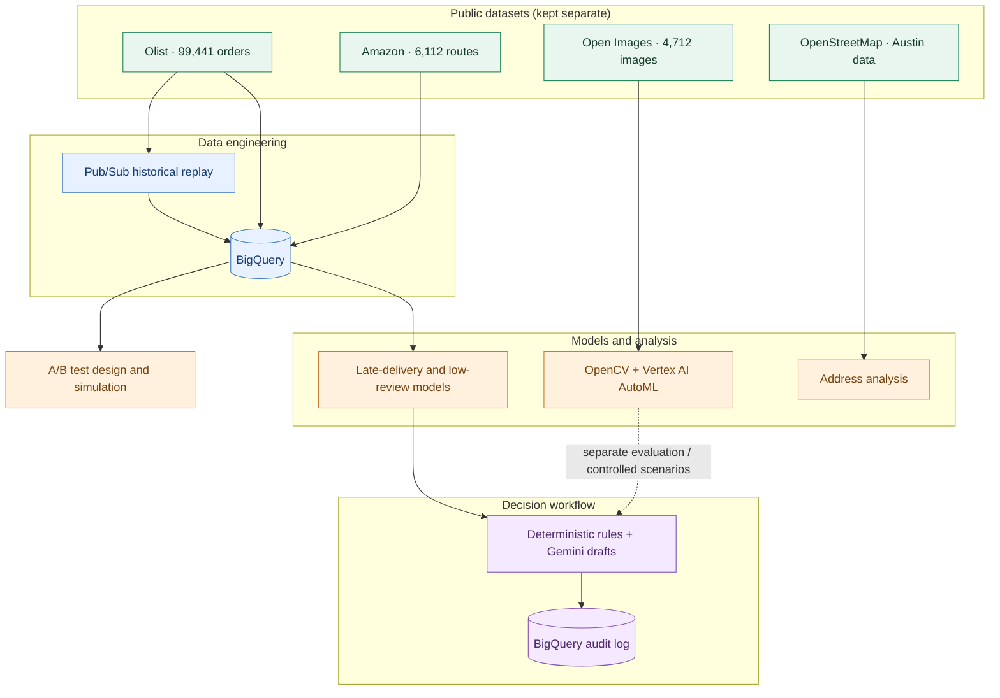

<div align="center">

# Delivery Experience Intelligence

### Predict delivery risks · Check package images · Make better outreach decisions


**[View the project presentation](https://docs.google.com/presentation/d/1dMVPmu7jhGnf5r54qxO6Emqcw6QEn9v4e-NpkpGVsvw/edit?usp=sharing)**

</div>

---

## At a glance

I built this project to explore how logistics companies could identify delivery problems earlier, rather than waiting for a late shipment or a poor review. It brings together historical order data, machine learning, computer vision, event streaming, and an AI-assisted decision workflow on Google Cloud.

The system was **built and evaluated with public datasets and historical replays**, not live customer deliveries. The different datasets are independent and are not joined into fictional order records.

| Orders analyzed | Streaming benchmark | Vision test accuracy | Agent decisions checked |
|:---:|:---:|:---:|:---:|
| **99,441** | **6,235 events/sec** | **99.6%** | **500/500** |

> **What these numbers mean:** Streaming throughput is from a benchmark; vision accuracy is on a held-out Open Images test set; 500/500 means the agent's decisions matched predefined rules, not that its predictions were 100% accurate.

## Tech stack

| Area | Technologies |
|---|---|
| **Languages & Data Engineering** | **Python, SQL, BigQuery, Cloud Storage, Pub/Sub** |
| **Machine Learning** | **scikit-learn, HistGradientBoosting, BigQuery ML** |
| **Computer Vision** | **OpenCV, Vertex AI AutoML** |
| **Generative AI & Agents** | **Gemini 2.5 Flash, deterministic decision rules, BigQuery audit logging** |
| **Experimentation & Engineering** | **A/B testing, power analysis, sequential monitoring, pytest, Docker, GitHub Actions** |

## Why I built it

A late delivery can mean extra operational work and a frustrating experience for the customer. I wanted to see how far I could get using the information available before a delivery goes wrong.

The project explores five connected questions:

1. Can purchase-time information help predict late deliveries or low reviews?
2. Can historical order updates be processed through a streaming pipeline?
3. Can computer vision identify whether a package is visible in an image?
4. Can an AI-assisted workflow draft outreach only when predefined rules call for it?
5. How could a company test whether early delay notifications actually help?

## System overview



**Important:** Olist, Amazon, Open Images, and OpenStreetMap come from unrelated sources, places, and time periods. Each module uses its own dataset. Cross-module examples use controlled scenarios, not invented joins.

## How it works

### 01 · Ingest and replay order events

I used Python, SQL, and BigQuery to process historical Olist orders. A Pub/Sub replay published **19,770 historical events** and reached **6,235 events/second** in the measured benchmark, with no message loss.

### 02 · Predict delivery risks

I trained models for **late delivery** and **low customer review** risk using scikit-learn and BigQuery ML. Features were restricted to information available at purchase time, and I used temporal train/test splits to reduce leakage.

### 03 · Check images

I trained a **Vertex AI AutoML package-visibility classifier** using **4,712 Open Images photos**. OpenCV handles basic blur and brightness checks; Gemini was evaluated separately for image assessment. These are general labeled images, **not actual proof-of-delivery photos**.

### 04 · Evaluate whether action is needed

The decision workflow uses predefined rules to decide whether to take no action or create a customer/driver notification draft. Gemini supports draft generation; it does not override the decision rules. **Nothing is sent automatically.**

### 05 · Verify and log decisions

I replayed **500 historical orders** through the cloud agent workflow. **496 required no action** and **4 produced customer outreach drafts**. An independent rule check matched **all 500 decisions**.

### 06 · Design an outreach experiment

I designed a customer-level A/B test comparing **normal delivery updates** with **early delay notifications**. It includes power analysis, sticky randomization, and sequential monitoring. The experiment was **simulated and validated, not run live**.

---

## Results

### Delivery risk models

| Prediction task | Model / environment | ROC-AUC |
|---|---|---:|
| Late delivery | HistGradientBoosting, local temporal split | **0.649** |
| Late delivery | Boosted trees, BigQuery ML | **0.616** |
| Low review | HistGradientBoosting, local temporal split | **0.601** |
| Low review | Boosted trees, BigQuery ML | **0.575** |

These results are better than random ranking but still modest. Purchase-time data cannot capture everything that happens during a delivery, and I wanted the evaluation to reflect that.

### Computer vision · Package visibility

| Metric | Held-out test result |
|---|---:|
| Accuracy | **99.58%** |
| Correct classifications | **469 / 471** |
| Package precision | **1.0000** |
| Package recall | **0.9910** |
| Per-class F1 | **0.9960 / 0.9955** |
| Vertex AI evaluation auPRC | **0.9937** |

The classifier made **no false-positive package predictions** in this held-out test set and missed **2 of 221** package images. This is a result on the selected Open Images data; it does not establish performance on real delivery photos.

| Image pipeline component | Reported evaluation | Role |
|---|---|---|
| OpenCV blur / brightness checks | 70.2% agreement with weak labels | Basic image-quality screening |
| Vertex AI AutoML | 99.6% accuracy on clean held-out test set | Main package visibility classifier |
| Gemini image evaluation | 64.6% agreement with weak labels | Additional image assessment |

*These figures come from different evaluation setups and are not directly comparable accuracy scores.*

### Streaming and agent

| Check | Result |
|---|---:|
| Pub/Sub throughput benchmark | **6,235 events/sec** |
| Historical events published | **19,770** |
| Message loss in benchmark | **0** |
| Historical orders evaluated by agent | **500** |
| No-action decisions | **496** |
| Customer outreach drafts | **4** |
| Decisions matching independently recomputed rules | **500 / 500** |
| Agent dry-run logic checks | **5 / 5** |

**500/500 refers to policy agreement**, not general AI prediction accuracy. The four messages were drafts only; no real customers were contacted.

### A/B experiment design

**Question:** Would an early warning about a possible delay improve customer experience compared with standard delivery updates?

| Design choice | Approach |
|---|---|
| Control | Standard delivery updates |
| Treatment | Additional early-warning message for eligible deliveries |
| Assignment | 50/50 at the customer level, with sticky assignment |
| Planned sample | ~750 customers per arm (~1,500 total) |
| Power | 80% under simulated effect assumptions |
| Sequential monitoring | O'Brien-Fleming boundaries |
| CUPED | Not applied; available covariates explained under 0.3% of variance |
| Status | **Designed and replay-validated; never run live** |

I used customer-level assignment because multiple orders from the same customer should not end up in different experiment groups. **No measured uplift or business impact is claimed.**

---

## A few visuals

### Where deliveries were late


In the Olist data, late-delivery rates varied by state: approximately **19.7% in Maranhão** versus **7.1% in Rio Grande do Sul**.

### How delays relate to reviews


Late orders received lower customer ratings on average, which motivated looking at late-delivery and low-review risk together.

### Route patterns in a separate Amazon dataset


**64.4%** of analyzed Amazon routes revisited a delivery zone. This is a separate route-analysis dataset, not a route history attached to Olist orders.

### Package visibility predictions


Twelve examples from the held-out image test set, showing predicted labels, confidence scores, and reference labels. All 12 examples shown are correct; the full test result is **469/471**.

## Run it locally

**Requirements:** Python 3.10+, about 2 GB of disk space, and internet access for the initial data downloads. The local workflow does not require a Google Cloud account.

**1. Set up a Python environment**

```bash
python -m venv .venv
source .venv/bin/activate
pip install -r requirements.txt
```

For Windows PowerShell, use `\.venv\Scripts\Activate.ps1` instead of the `source` command.

**2. Download the public datasets**

```bash
python scripts/download_olist.py --out data/raw/olist
python scripts/download_amazon.py --out data/raw/amazon
```

**3. Run the tests**

```bash
pytest tests/ -q
```

**4. Train the local risk models**

```bash
python -c "from src.ml import train_all; train_all('data/raw/olist', 'evals/risk'); print('Metrics written to evals/risk/')"
```

**5. Run the agent demo**

```bash
python scripts/demo_end_to_end.py --olist-dir data/raw/olist
```

**6. Replay events locally**

```bash
python scripts/e2e_local.py --orders 2000
```

The project includes **31 automated tests**. Evaluation outputs are saved under `evals/`.

## Google Cloud implementation

The cloud workflows ran on Google Cloud using BigQuery, Pub/Sub, Vertex AI, and Gemini. Reproducing them requires a GCP project with billing, authenticated Google Cloud CLI access, and the APIs documented in [`docs/operations/gcp-setup.md`](docs/operations/gcp-setup.md).

<details>
<summary><strong>Show cloud commands</strong></summary>

**BigQuery tables, views, and risk model**

```bash
bq query --use_legacy_sql=false < sql/bigquery_ddl.sql
bq query --use_legacy_sql=false < sql/dashboard_views.sql
bq query --use_legacy_sql=false < sql/bqml_late_delivery.sql
```

**Pub/Sub historical event replay**

```bash
python gcp/publish_events.py
```

**Vertex AI image dataset and training (Cloud Shell / bash)**

```bash
bash gcp/fetch_s3.py
bash gcp/stage3.sh
```

**Independent agent audit verification**

```bash
python gcp/verify_agent_audit.py
```

</details>

Cloud training and API calls may incur costs. See [`docs/operations/cost-ledger.md`](docs/operations/cost-ledger.md) for the recorded project costs.

### What runs where?

| Component | Local | Google Cloud |
|---|:---:|:---:|
| Automated tests (31) | | Not required |
| scikit-learn risk models | | Not required |
| Agent demo and experiment simulation | | Cloud agent also evaluated |
| BigQuery warehouse and BigQuery ML | No | |
| Event processing | Local replay | Pub/Sub |
| AutoML training and batch prediction | No | Vertex AI |
| Gemini image evaluation | No | |

## What I learned and what I'd improve

- **Risk prediction is difficult with early information.** ROC-AUC scores around 0.6 show some signal, but live operational features would be needed to explore better performance.
- **High image accuracy needs context.** The 99.6% result is from a held-out public image dataset, not real proof-of-delivery photos.
- **Decision verification matters.** All 500 replayed agent decisions followed the specified rules, but that is different from proving the rules themselves improve outcomes.
- **A/B tests need to be planned before claiming impact.** I implemented the design and simulation, but no live treatment effect was measured.
- **Separate datasets should stay separate.** The project uses Olist, Amazon, OpenStreetMap, and Open Images for different tasks without implying they describe the same deliveries.
- **Cloud work needs cost and execution controls.** I documented setup, evaluation, and operational decisions to make the implementation easier to reproduce.

## Repository guide

```text
delivery-experience-intelligence/
├── src/
│   ├── ingestion/       Dataset download and validation
│   ├── streaming/       Event schemas and replay
│   ├── ml/              Risk models and evaluation
│   ├── vision/          OpenCV, AutoML, Gemini evaluation
│   ├── address/         OpenStreetMap analysis
│   ├── agents/          Decision rules and audit logging
│   ├── experiments/     A/B test design and simulation
│   └── api/             API components
├── gcp/                 Cloud scripts
├── sql/                 BigQuery tables, views, and models
├── scripts/             Local runners and charts
├── tests/               Automated tests
├── evals/               Saved evaluation results
├── data/vision/         Image dataset manifests
├── dashboard/           Chart previews
├── docs/                Architecture, operations, presentation
├── docker/              Container configuration
└── .github/workflows/    CI
```

For more detail, see [`STATUS.md`](STATUS.md), [`EXECUTION_REPORT.md`](EXECUTION_REPORT.md), and [`docs/decisions/`](docs/decisions/).

## Datasets and licensing

| Dataset | Source | License / note |
|---|---|---|
| Olist Brazilian E-Commerce | Olist public dataset | Attribution requirements apply |
| Amazon Last-Mile Routing | AWS Registry of Open Data | CC BY-NC 4.0 |
| OpenStreetMap (Austin) | OpenStreetMap / Overpass API | ODbL |
| Open Images | Official CVDF S3 mirror | CC BY 4.0 annotations; image licenses may vary |

Raw datasets are not committed to this repository. Download scripts and manifests are included instead.

---

<div align="center">

**Built with Python, SQL, Google Cloud, Vertex AI, and Gemini.**

**[See the 9-slide project showcase](https://docs.google.com/presentation/d/1dMVPmu7jhGnf5r54qxO6Emqcw6QEn9v4e-NpkpGVsvw/edit?usp=sharing)**

</div>
