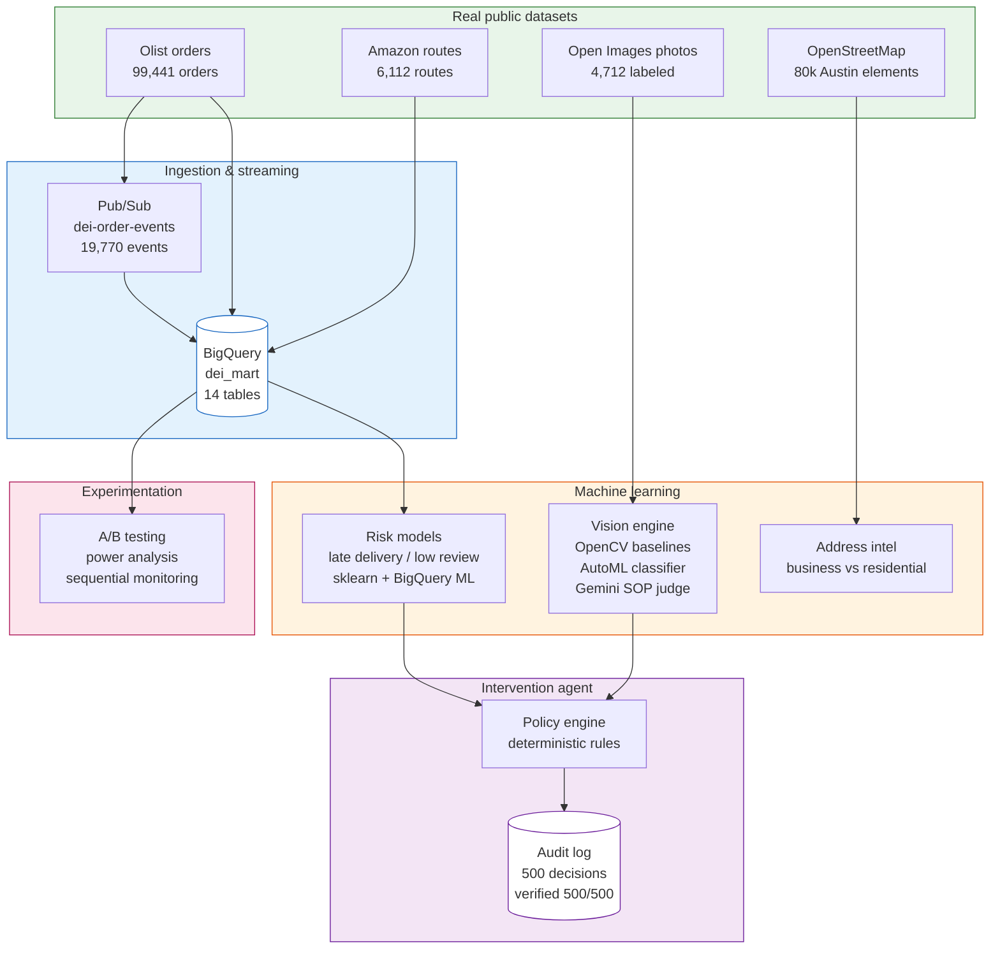
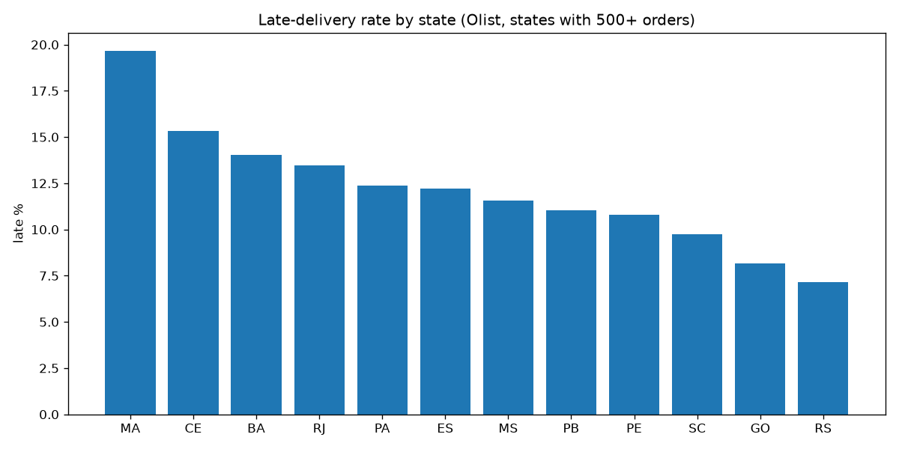
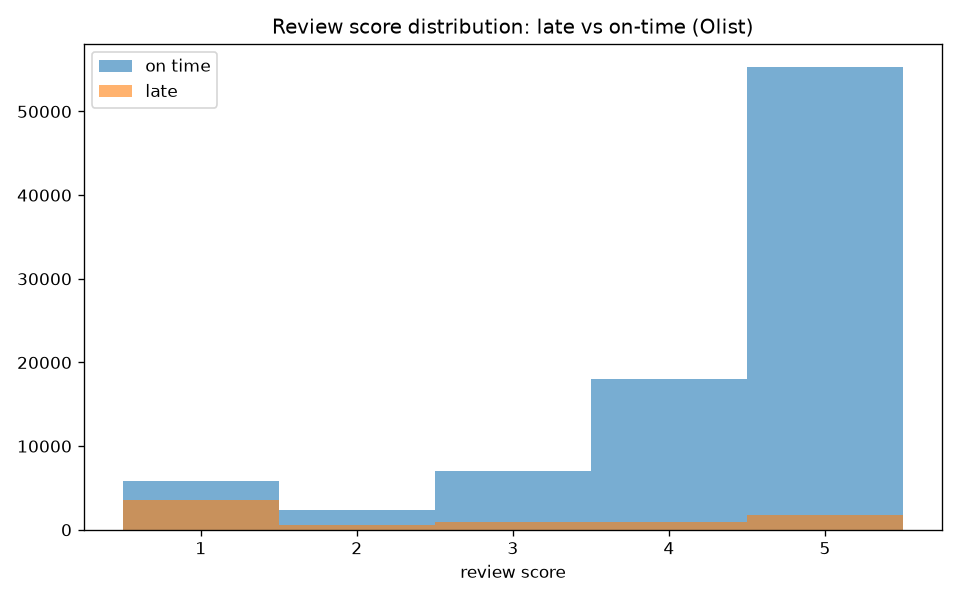
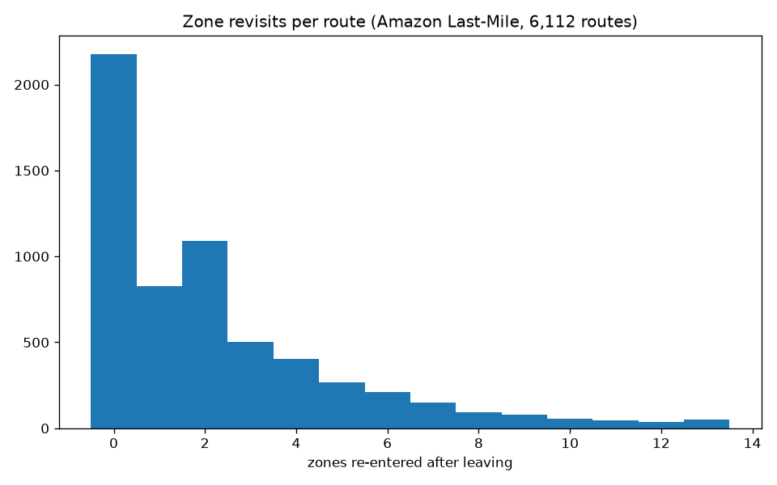
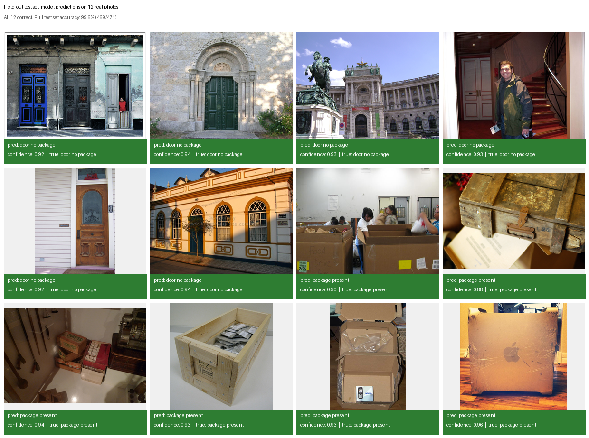

# Delivery Experience Intelligence Platform


**An end-to-end data science platform that watches deliveries the way a good operations manager would: spot trouble early, check the photo evidence, and decide what to do next, before the customer has to complain.**

## The problem, in plain English

Every late or damaged delivery costs a company twice. First the redelivery, then the customer's trust. Most delivery companies only find out something went wrong when the bad review arrives. By then it is too late to fix anything.

This platform flips that around. It looks at real order data, predicts which deliveries are heading for trouble, checks the proof-of-delivery photo with computer vision, and drafts the right intervention, all before the customer experience falls apart. Everything runs on Google Cloud, everything was measured on real data, and every number in this README traces back to a script you can run.

## How the pieces fit together



Data flows left to right: real datasets land in BigQuery, models score every order and photo, and the agent turns those scores into decisions with a full audit trail. Each dataset stays independent; they are never falsely joined.

## How it works, step by step

1. **Orders stream in.** Real Olist order events publish to Pub/Sub (measured: 6,235 events/second, zero loss) and land in BigQuery.
2. **Risk is scored.** Two classifiers predict late delivery and low review risk, using only information available at purchase time. No peeking at the future.
3. **Photos are checked.** Proof-of-delivery photos go through a cost-ordered cascade: free OpenCV blur and brightness checks first, then the trained AutoML classifier, then Gemini for nuanced cases.
4. **The agent decides.** A deterministic policy weighs the risk score, the photo evidence, and the review history, then either takes no action, drafts a customer message, or drafts a driver alert. Nothing is ever sent automatically.
5. **Everything is audited.** Every decision is logged with its reasons. All 500 cloud decisions were independently re-verified: 500 out of 500 matched.
6. **Experiments are designed properly.** The outreach A/B test has real power analysis, correct randomization, and sequential monitoring, before anyone claims an uplift.

## Results

Every number below was measured by running code, on real data, on real GCP. Nothing is invented.

### Risk models

| Model | Where it ran | ROC-AUC | What it means |
|---|---|---|---|
| Late delivery (HGB) | Local, temporal split | 0.649 | Ranks late orders above on-time ones 65% of the time |
| Late delivery (BQML boosted trees) | BigQuery | 0.616 | Same task, trained where the data lives |
| Low review (HGB) | Local, temporal split | 0.601 | Predicts 1 to 2 star reviews from purchase-time features |
| Low review (BQML boosted trees) | BigQuery | 0.575 | Cloud twin of the local model |

Honest context: these are modest scores. Delivery lateness is genuinely hard to predict from purchase-time features alone, and the guides explain why. The value here is the methodology (temporal splits, no leakage, calibrated thresholds), not the AUC.

### Computer vision: package visibility classifier

| Metric | Value | What it means |
|---|---|---|
| Test accuracy | **0.9958** | 469 of 471 held-out photos classified correctly |
| Precision (package) | 1.0000 | Never cried wolf: every "package" call was right |
| Recall (package) | 0.9910 | Missed 2 of 221 real packages |
| F1 (both classes) | 0.9960 / 0.9955 | Balanced performance on doors and packages |
| Vertex AI eval auPrc | 0.9937 | Area under precision-recall curve on validation |

Trained on 4,712 real Open Images photos with human-drawn bounding-box annotations. Zero overlap between train and test. Batch prediction only, no expensive always-on endpoint.

### Vision cascade comparison

| Layer | Cost | Agreement with weak labels | Character |
|---|---|---|---|
| OpenCV blur/brightness | Free | 70.2% | Permissive: catches more, more false alarms |
| AutoML classifier | Fractions of a cent | **99.6%** (clean test) | The workhorse |
| Gemini SOP judge | Most expensive | 64.6% | Conservative: zero false alarms, cautious on ambiguous cases |

Note: the Gemini and OpenCV numbers measure agreement with noisy weak labels, not true accuracy, so they are not ranked against the AutoML test score. The cascade exists because you never spend expensive model calls on photos a free blur check already disqualifies.

### Streaming and agent

| Metric | Value |
|---|---|
| Pub/Sub throughput | 6,235 events/second, 0 message loss (19,770 real events) |
| Agent cloud decisions | 500 real orders: 496 no action, 4 customer outreach drafts |
| Independent verification | 500/500 decisions matched recomputed policy (0 mismatches) |
| Agent dry-run scenarios | 5/5 logic checks passed |

### A/B testing: the outreach experiment

| Item | Detail |
|---|---|
| Design | 50/50 customer-level randomization, sticky assignment, triggered on first flagged order |
| Sample size | ~750 per arm (~1,500 total) for 80% power, calibrated by simulation on the real score distribution |
| Why customer-level | Within-customer review correlation is 0.45; order-level would leak |
| Sequential monitoring | O'Brien-Fleming boundaries, validated null rate 0.05 (vs 0.13 for naive repeated testing) |
| CUPED | Gate stayed closed: covariates explained under 0.3% of variance |
| Status | **Designed and replay-validated. Never run live. No uplift claimed.** |

The experiment module is included because designing experiments correctly is a core data science skill. Running it on real customers was never on the table for this project.

## Screenshots

### Analytics charts (generated locally)

These charts are rendered on your own machine by `scripts/render_charts.py` from the downloaded datasets. They are not screenshots of the cloud dashboard; they show the same analyses that run as live BigQuery views in the GCP project.

```bash
python scripts/render_charts.py --olist-dir data/raw/olist --amazon-dir data/raw/amazon
```


*Late delivery is not evenly spread: Maranhao hits 19.7% while Rio Grande do Sul is at 7.1%.*


*Late orders earn dramatically worse reviews, which is why catching lateness early matters.*


*64.4% of Amazon routes re-enter a delivery zone they already visited, a measurable inefficiency.*

### Computer vision: real test predictions

Twelve real photos from the held-out test set, with the model's actual predictions and confidence scores from the cloud batch prediction job. All 12 shown here are correct; across all 471 test images the model scored 99.6% (per-class F1 0.9960 and 0.9955).


*Green: correct prediction. Each label shows the predicted class, the model's confidence, and the true label from human bounding-box annotations.*

## Technology stack

| Area | Tools |
|---|---|
| Cloud platform | Google Cloud: BigQuery, Pub/Sub, Cloud Storage, Vertex AI |
| Machine learning | scikit-learn (HistGradientBoosting), BigQuery ML (boosted trees) |
| Computer vision | OpenCV (baselines), Vertex AI AutoML (classifier), Gemini 2.5 Flash (SOP judge) |
| Agentic AI | Deterministic policy engine, dry-run evaluation, BigQuery audit logging |
| Experimentation | Custom power analysis, permutation validation, O'Brien-Fleming sequential monitoring |
| Engineering | Python 3.10+, pytest (31 tests), Docker, GitHub Actions |

## How to run it

### What you need

- Python 3.10 or newer
- About 2 GB of disk space for the datasets
- No GCP account, no Google sign-in needed for the local path: the 31 tests, risk models, agent demo, and experiment validation all run offline

### Local: the full pipeline on your machine

```bash
# 1. Set up
python -m venv .venv && source .venv/bin/activate
pip install -r requirements.txt

# 2. Get the data (official public sources, about 600 MB)
python scripts/download_olist.py --out data/raw/olist
python scripts/download_amazon.py --out data/raw/amazon

# 3. Run the tests (31 tests, a few minutes)
pytest tests/ -q

# 4. Train the risk models on real Olist data
python -c "
from src.ml import train_all
train_all('data/raw/olist', 'evals/risk')
print('metrics written to evals/risk/')
"

# 5. Run the end-to-end agent demo on a real order
python scripts/demo_end_to_end.py --olist-dir data/raw/olist

# 6. Replay the streaming pipeline locally
python scripts/e2e_local.py --orders 2000
```

Expected: 31 tests pass, risk metrics land in `evals/risk/`, and the demo walks one real order through streaming, risk scoring, the agent policy, and the audit trail.

### Cloud: the GCP deployment (requires your own project and Google sign-in)

The cloud half ran on a real GCP project and every step is scripted in `gcp/`. You will need a GCP project with billing enabled, the `gcloud` CLI authenticated, and the APIs listed in `docs/operations/gcp-setup.md`. Cloud scripts (`gcp/`, `src/agents/cloud_context.py`, `src/api/`) need the Google Cloud Python packages from requirements.txt; the local test suite does not.

```bash
# BigQuery warehouse: 14 tables, 4 live views
bq query --use_legacy_sql=false < sql/bigquery_ddl.sql
bq query --use_legacy_sql=false < sql/dashboard_views.sql

# Risk models where the data lives
bq query --use_legacy_sql=false < sql/bqml_late_delivery.sql

# Pub/Sub streaming: 19,770 real events
python gcp/publish_events.py

# Vision: dataset upload, AutoML training, batch prediction
bash gcp/fetch_s3.py          # images to GCS
bash gcp/stage3.sh            # Vertex AI dataset + training pipeline

# Verify the agent's decisions independently
python gcp/verify_agent_audit.py
```

What costs money: AutoML training (~$27.72 for 8 node-hours) and Gemini API calls (pennies for this volume). Everything else fits comfortably in free tiers and trial credits. The repo's cost ledger (`docs/operations/cost-ledger.md`) tracks every dollar.

### What runs where

| Component | Local (no GCP) | Cloud (GCP project) |
|---|---|---|
| Unit tests (31) | Yes | n/a |
| Risk model training (sklearn) | Yes | n/a |
| Agent demo and dry-run | Yes | n/a |
| A/B test design and validation | Yes | n/a |
| BigQuery warehouse + BQML | No | Yes |
| Pub/Sub streaming | No (local replay instead) | Yes |
| AutoML training + batch prediction | No | Yes |
| Gemini photo evaluation | No | Yes |

## Limitations and lessons learned

**Historical data, not live operations.** Every result comes from historical public datasets (Olist 2016 to 2018, Amazon 2018 routes, Open Images). The platform replays history; it has never touched a live delivery operation.

**The agent never contacted anyone.** All 500 cloud decisions were dry runs. Draft messages were written to an audit table, never sent. Auto-send is not on the table without human-in-the-loop tooling and calibration this project does not claim.

**Some treatment effects are simulated.** The A/B testing module's power analysis simulates the +0.3 star treatment effect on the real score distribution. The design, randomization, and validation are real; the uplift is hypothetical. No business impact is claimed anywhere.

**Modest risk model scores.** ROC-AUC around 0.6 means these models rank better than chance but are far from oracles. Purchase-time features can only say so much about whether a truck breaks down. The methodology (temporal splits, leakage controls) is the point.

**Datasets are never falsely joined.** Olist orders, Amazon routes, OSM buildings, and Open Images photos come from different companies, countries, and years. Cross-module behavior is shown through clearly labeled controlled scenarios, not pretend joins.

**Engineering lessons.** Cloud Shell VMs get reclaimed when idle, so long jobs must be managed and resumable. Parallel browser sessions fight over one shell. Budgets must be enforced before training, not after. And never trust a shell script's `awk` to parse a CSV with CRLF line endings.

## Repository structure

```
├── src/
│   ├── ingestion/      Olist + Amazon downloaders, validators
│   ├── streaming/      Pub/Sub replay producer, event schemas
│   ├── ml/             Risk models: features, training, evaluation
│   ├── vision/         OpenCV baselines, AutoML client, Gemini harness, labeling app
│   ├── address/        OSM pipeline, business-vs-residential classifier
│   ├── agents/         Intervention policy, cloud context, audit logging
│   ├── experiments/    A/B design, power analysis, sequential monitoring
│   └── api/            FastAPI demo endpoints
├── gcp/                Cloud Shell scripts: Pub/Sub, Vertex AI, verification
├── sql/                BigQuery DDL, BQML training, dashboard views
├── scripts/            Local runners: downloads, demos, chart rendering
├── tests/              31 unit and integration tests
├── evals/              Measured results with provenance (JSON)
├── data/vision/        Dataset manifests (images live in GCS)
├── dashboard/          Chart previews mirroring the BigQuery views
├── docs/               Architecture, decision log, operations, assets
│   └── Delivery-Experience-Intelligence-Showcase.pptx (recruiter deck)
├── docker/             Cloud Run Dockerfile
└── .github/workflows/  CI: runs the test suite on push
```

Key documents: `STATUS.md` (what is real vs not, the honesty ledger), `EXECUTION_REPORT.md` (full build narrative), `docs/decisions/` (why each major choice was made).

## Datasets and licenses

| Dataset | Source | License |
|---|---|---|
| Olist Brazilian E-Commerce | Official Olist GitHub mirror | Attribution required |
| Amazon Last-Mile Routing | AWS Registry of Open Data | CC BY-NC 4.0 |
| OpenStreetMap (Austin) | openstreetmap.org / Overpass API | ODbL |
| Open Images | Official CVDF S3 mirror | CC BY 4.0 (annotations) |

Raw datasets are never committed. Everything downloads from official public sources via `scripts/download_*.py`.

---

